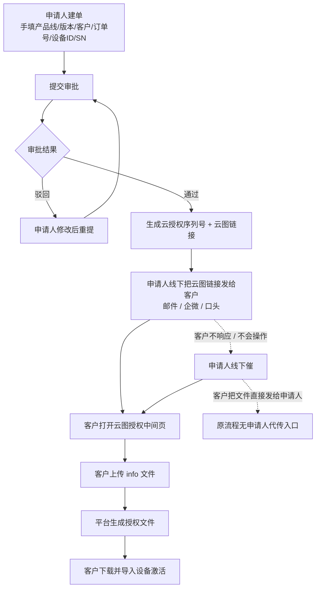
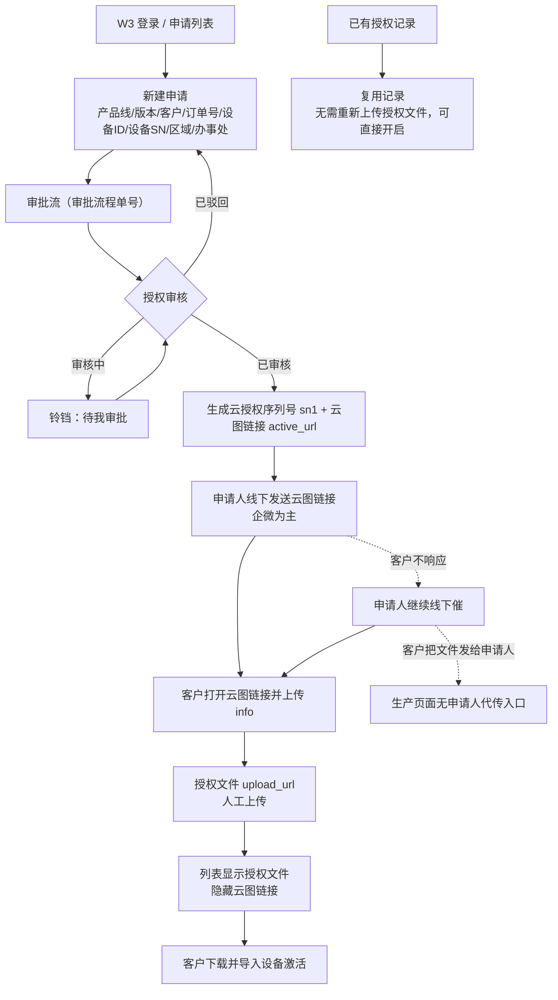
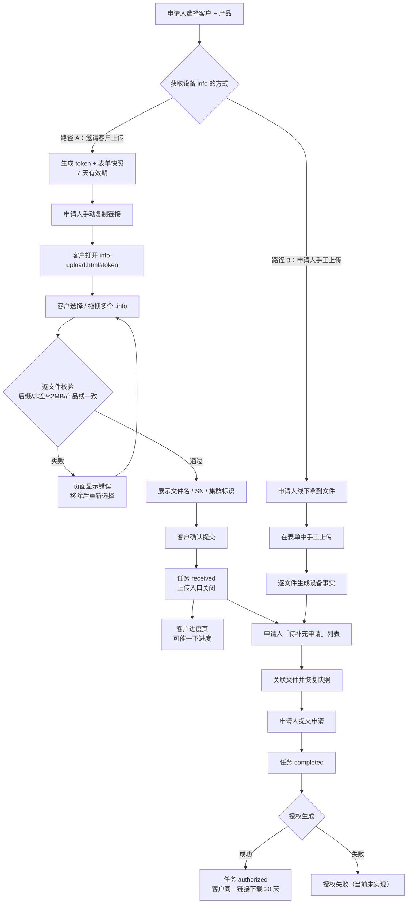
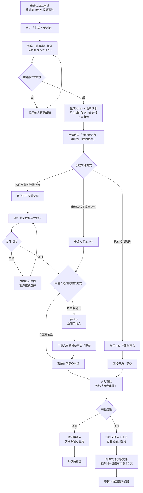
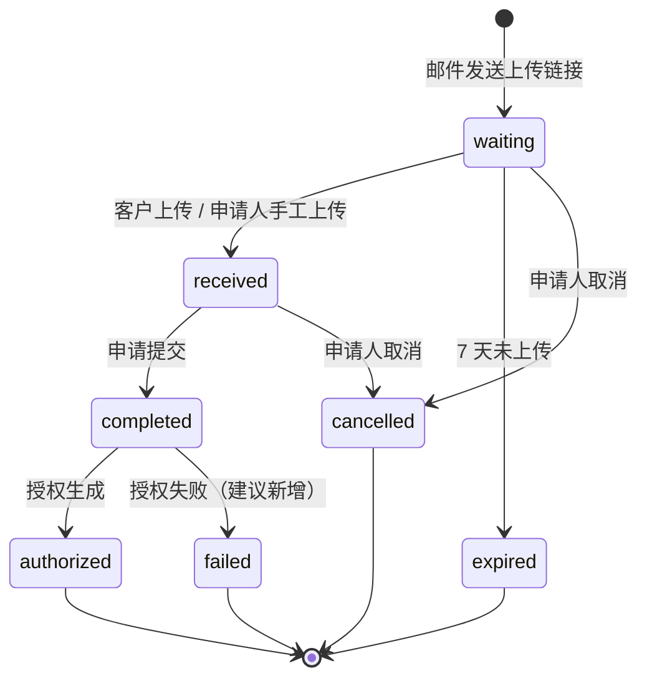

# 授权文件上传中间页 · 流程图对比

> 版本：2026-10-19  
> 范围：原流程 / 现在生产环境 / Demo 中间页（当前）/ 目标流程（定稿）
>
> **推荐阅读**：`docs/flowcharts-readable.html`（手写排版的流程说明页，无需联网）  
> 已渲染图片（PNG / SVG）：`docs/flowcharts/01-原流程.*`、`02-现在生产环境.*`、`03-Demo中间页.*`、`04-目标流程.*`  
> Mermaid 交互预览：`docs/flowcharts.html`（需联网加载 Mermaid CDN）

---

## 0. 三种流程对比

| 维度 | ① 原流程 | ② 现在生产环境 | ③ Demo 中间页（当前） |
|---|---|---|---|
| 设备信息来源 | 申请人手填设备 ID/SN | 申请人手填设备 ID/SN | 客户上传 `.info`；也支持申请人手工上传 |
| 客户参与时机 | 审批通过后 | 审批通过后 | 申请提交前 |
| 审批依据 | 手填数据 | 手填数据 | 文件解析出的设备事实 |
| 上传链接发送 | 申请人手动（企微为主） | 申请人手动（企微为主） | 申请人手动复制链接 |
| 客户上传入口 | 云图授权中间页 | 云图授权中间页 | `info-upload.html#token` |
| 申请人代客户上传 | 不支持 | 不支持 | 支持 |
| 通知中心 | 无 | 铃铛「待我审批」 | 未接入 |
| 续期/复制复用 | 无 | 已有记录可复用 | 未实现 |
| 跨设备 | 支持 | 支持 | 不支持（Demo 边界） |

---

## 1. 原流程（旧旅程）

**特点**

- 先审批、后验证设备；
- 客户是后置参与者；
- 申请人承担全部线下协调；
- 授权文件在客户上传后才生成。

---

## 2. 现在生产环境流程

**特点**

- 生产环境把审批、序列号、云图链接、授权文件状态系统化；
- 但没有改变“先审批、后验证设备”的顺序；
- 通知中心只有「待我审批」；
- 上传链接仍要人工发送；
- 授权文件人工上传，已有记录可复用。

---

## 3. Demo 中间页流程（当前实现）

**交互入口（2026-10-20 调整，同日复审后定稿）**

- 表单填写阶段设备信息为非必填：只保留硬件信息文件上传控件，不提前放“发送链接”入口，也不做“我自己上传 / 让客户上传”的模式单选；
- 点击提交时若没有设备信息文件，弹出「还缺少设备信息」引导：说明可以自己上传，或把链接发给客户后先继续填写；“已填写的申请会保留，客户上传后到「我的待办」确认”；
- 引导内提供「我自己上传」「发送链接让客户上传」「继续填写」三个动作；发送链接后字段原地变为任务卡（等待客户上传 / 客户已上传待确认），可查看链接或“改由我上传”；
- 设备 ID 只用于识别设备，不能替代 `.info` 文件；借测单只带入设备 ID/集群标识，不再伪造已上传文件；
- 发送结果弹窗提供「继续填写申请」返回表单，申请人可以先填完其他内容再回来确认；
- 上传方在本流程内统一称“外部”，相关引导、弹窗、状态卡与待办不再使用“客户”；
- 发送结果弹窗与等待任务卡提供「复制文案」，一键复制包含名称、产品/方案、上传链接和有效期的转发文案，便于申请人通过邮件、企微或其他渠道转发。

**当前缺口**

- 路径 A / B 没有互斥与合并规则；
- 没有“客户上传后立即发起 / 由我确认”的触发方式；
- 没有通知中心对接；
- 没有邮件自动发送；
- 没有授权记录复用；
- 申请人手工上传后，收集任务仍挂着。

---

## 4. 目标流程（定稿）

---

## 5. 收集任务状态机

---

## 6. 关键规则速查

| 规则 | 结论 |
|---|---|
| 上传链接发送方式 | 仅邮件；平台不联动企微，不提供复制链接 |
| 客户邮箱填写时机 | 点击「发送上传链接」时弹窗填写，不改申请表单 |
| 触发方式默认值 | B（客户上传后由我确认） |
| 触发方式 A 的前提 | 除设备 info 外全部必填与业务校验通过 |
| 客户校验展示 | 文件格式、空文件、大小、产品线、SN/集群解析逐项展示 |
| 客户上传后 | 触发方式 A 自动提交；B 停在待确认并通知申请人 |
| 线下文件 | 申请人手工上传；与邮件链接互斥，链接失效 |
| 文件传错 | 不允许客户替换；申请人重新发起收集，旧链接失效 |
| 7 天未上传 | 邮件提醒客户；申请人「我的待办」提示 |
| 授权文件 | 人工上传；已有授权记录可复用，直接开启 |
| 续期/复制 | 复用授权记录中的 info 与设备事实 |
| 授权记录 | 只收已提交申请；待设备信息状态不进授权记录 |
| 通知中心 | 现有「待我审批」；新增「我的待办」承载申请人事件 |
