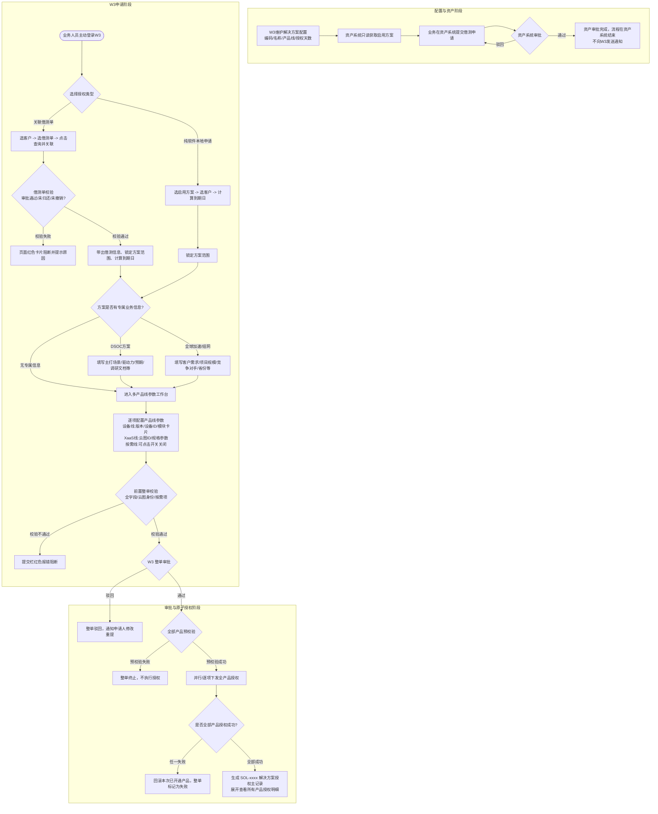

# 解决方案型测试授权申请需求方案

> **文档版本**：V2.0 完整业务与功能需求规格说明书  
> **最后更新**：2026-09-20  
> **适用范围**：关联新资产系统借测单的解决方案型申请、W3 本地纯软件解决方案型申请、解决方案配置维护及授权记录管理  
> **基线来源**：`docs/解决方案型测试授权需求方案.docx`（初稿）、`测试设备授权平台V2.html` 原型、`方案型授权操作手册.docx`、`handoff.md`  

---

## 1. 背景与目标

### 1.1 业务背景
解决方案型测试授权通常由多个协同运作的产品线打包组成（例如包含 HCI、AC、NGAF、AD、WOC、SaaS-XDR 的“企业云一体化方案”，或包含 XDR、STA、AF、aES 的“分布式安全运营方案”）。以往业务中，由于资产借测与测试授权系统割裂，业务人员往往需要按单产品反复发起多次授权申请，流程繁琐且难以保证同一方案下各产品授权期限与客户环境的一致性。

本方案确立了由 W3 测试授权系统统一维护“解决方案与产品线”配置关系，并向新资产系统开放查询能力的架构；新资产系统在借测申请时复用该配置，但其审批通过后不向 W3 推送消息，亦不自动触发 W3 创建授权。业务人员在借测审批通过后，主动进入 W3 关联该借测单，系统自动锁定已审批的方案及产品线范围，并带出客户与设备等基础数据，申请人仅需补充授权所需的技术参数与业务信息，提交 W3 整单审批并完成一键原子授权。

### 1.2 核心目标
1. **统一配置源头**：由 W3 统一维护解决方案与产品线对应关系及统一授权天数，避免跨系统重复定义。
2. **流程解耦独立**：资产借测审批与 W3 授权审批保持独立职责，新资产系统审批不自动驱动 W3 建单，W3 重新进行整单授权合规审批。
3. **高效信息复用**：通过关联借测单直接带出客户、方案、产品线、设备和期限等已审批事实，消除二次手工录入成本。
4. **严格范围锁定**：确保 W3 申请中的方案与产品线严格以资产审批或启用配置为准，只读锁定，杜绝申请人擅自调换产品。
5. **原子授权与回滚**：整套解决方案作为一张申请单整体审批，全部产品授权成功方为整单成功；任一产品失败整单回滚，不产生部分交付的残缺授权。
6. **单一汇总记录**：授权成功后在授权记录中生成唯一的 `SOL-...` 解决方案主记录，展开后查看各产品明细，保持列表整洁。
7. **灵活配置与免开发扩展（业务方核心诉求）**：建立方案与产品组合、业务申请信息的解耦机制与配置化能力，避免未来方案推广与业务字段调整带来频繁的代码硬编码开发。

---

## 2. 核心原则与业务结论

1. **配置归属 W3**：W3 提供“解决方案配置”管理能力，维护解决方案与产品线的映射关系、方案启停状态及统一授权天数（`authDays`），不维护各产品的底层版本、设备规格或细粒度功能开关。
2. **资产系统只读获取**：新资产系统仅通过接口获取启用状态的解决方案及产品线配置，用于借测建单，不打开亦不嵌入 W3 配置页。
3. **两套流程完全独立**：新资产系统审批通过后不向 W3 发送业务消息，W3 不自动创建申请、授权任务或授权记录。
4. **用户主动发起申请**：业务人员完成借测审批后，主动进入 W3 选择“关联借测单”并发起解决方案型授权申请。
5. **严格的借测单准入门槛**：W3 仅允许关联状态为“审批通过且未归还、未撤销”的借测单；未审批、已归还、已撤销或接口异常的借测单坚决阻断。
6. **方案与产品线只读锁定**：方案与产品线范围完全以借测单审批内容或启用配置为准，在 W3 申请页呈只读展示，严禁申请人手工增加、删除或替换产品线。
7. **设备产品线与 XaaS 并存**：同一个解决方案的产品线可同时包含设备产品线（如 HCI、AF、AC）与 XaaS 产品线（如 SASE-GA、SASE-ZTNA、SaaS-XDR），支持混排申报与统一交付。
8. **客户云图身份强校验**：方案中只要包含任一 XaaS 产品线，授权对象即以客户的云图身份（云图账号 + 云图ID / `tenantId`）为准，客户缺失有效云图身份时直接阻断整单提交。
9. **统一授权时间模型**：方案配置中维护“授权时间（天）”（如 30 天、60 天、90 天），申请时按当天日期加天数动态计算统一授权到期日，方案下所有产品线的授权期限强制锁定该到期日，不允许各产品线分散填报。
10. **W3 整单统一审批**：一套解决方案作为一张完整的申请单进入 W3 审批流，不按产品线拆单。任一节点驳回则整单驳回。
11. **全产品原子授权**：方案内全部产品（设备与 XaaS）授权均执行成功，整单才算成功；任一产品下发失败，整单标记为失败，并立即调用下游作废接口回滚本次已成功创建的产品授权。
12. **单条汇总授权记录**：在授权记录列表中生成一条以 `SOL-` 开头的解决方案主记录，支持展开查看方案下每个产品的版本、设备ID/云图ID、SN、期限和授权码明细。
13. **纯软件方案本地闭环**：无需借测硬件的纯软件解决方案，可直接在 W3 选择已启用方案发起本地申请，不依赖借测单，同样享受整单审批与原子授权机制。
14. **业务申请信息与产品组合灵活配置（业务方要求）**：不同方案（如分布式安全运营、全球加速、全球组网）所需的业务评估信息与产品组合具备元数据驱动能力，支持配置化扩展，避免每次新增方案或增减字段重新开发发版。

---

## 3. 系统边界与数据归属

### 3.1 系统职责矩阵

| 系统 | 核心职责（负责） | 系统边界（不负责） |
| :--- | :--- | :--- |
| **W3 测试授权系统** | 1. 维护解决方案与产品线映射及授权天数配置<br>2. 向资产系统提供启用配置查询接口<br>3. 提供借测单校验与信息带出能力<br>4. 提供方案范围锁定与多产品线参数工作台<br>5. 执行 W3 业务合规整单审批<br>6. 调度下游中台执行原子授权与失败整单回滚<br>7. 生成并展示解决方案汇总及展开明细记录 | 1. 不创建、修改或审批资产借测单<br>2. 不接受资产系统审批结果直接驱动建单<br>3. 不维护底层产品的设备兼容性或中台规则细节 |
| **新资产系统** | 1. 通过只读接口获取 W3 启用的解决方案与产品线列表<br>2. 支持用户在借测单中选择方案并完成资产审批<br>3. 保存已审批的方案、产品线及设备等借测单完整快照<br>4. 提供借测单状态查询与明细查询接口 | 1. 不调用 W3 接口自动创建测试授权<br>2. 不维护 W3 的解决方案配置数据<br>3. 不干预 W3 内部的授权审批与下发 |
| **下游许可证平台 / 云图中台** | 1. 接收 W3 下发的产品授权或云服务开通请求<br>2. 返回具体授权码、实例开通结果或错误明细<br>3. 提供已下发授权的作废、撤销与回滚接口能力 | 1. 不处理解决方案维度的业务审批<br>2. 不参与借测单准入及客户合法性校验 |

### 3.2 数据归属与权威系统

| 数据对象 | 权威系统 | 说明 |
| :--- | :--- | :--- |
| **解决方案与产品线配置** | W3 测试授权系统 | 包含方案编码、名称、关联产品线、授权天数及启停状态；资产系统只读同步。 |
| **借测单与资产审批状态** | 新资产系统 | 借测单号、借测使用人、借测期限、借测状态、归还/撤销状态；W3 仅作只读查询。 |
| **本次借测锁定方案范围** | 新资产系统（审批快照） | 借测单审批通过时的方案及产品线快照，W3 关联后必须原样带出并锁定。 |
| **W3 申请单与业务申请信息** | W3 测试授权系统 | 包含申请来源、客户身份、方案专属业务评估信息、多产品线授权参数快照。 |
| **产品授权码与交付状态** | W3 / 下游平台 | 下游生成具体授权码，W3 汇总状态并维系方案原子事务。 |
| **解决方案授权记录** | W3 测试授权系统 | 一套方案一条主记录（SOL编号），内含全部产品的明细列表快照。 |

---

## 4. 业务流程架构



---

## 5. 功能模块详细需求（五段式标准）

---

### 5.1 解决方案配置管理

#### 1、初始状态
1. 系统由管理员在配置中心统一维护解决方案与产品线关系的基座配置。
2. 初始状态下，系统展示已维护的解决方案定义清单，包含方案编码、方案名称、关联产品线集合、统一授权天数及当前启用状态；默认按更新时间倒序排列。
3. 新资产系统通过接口同步读取处于“启用”状态的方案配置；若系统中未配置任何方案或方案全部处于停用状态，测试授权申请端不可发起解决方案型授权。

#### 2、交互逻辑说明
1. **列表检索与筛选**：管理员可按方案编码或方案名称进行关键字模糊检索，或按状态（全部/启用/停用）筛选方案列表。
2. **新增方案**：支持录入方案编码（全局唯一，新增后锁定不可修改）、方案名称、统一授权天数（正整数），并勾选其所包含的产品线范围（支持硬件设备产品线与 XaaS 云服务产品线混选）。
3. **编辑方案**：方案编码锁定只读，允许修改方案名称、授权天数和勾选的产品线组合。
4. **启停切换**：支持对已有方案进行一键启用/停用切换，停用后新资产系统与测试授权申请端即时不可选。
5. **模拟读取**：提供模拟接口读取功能，支持实时查看新资产系统调用的方案配置快照。

#### 3、字段校验规则
1. **方案编码**：必填且全局唯一，不可包含特殊字符，新增后锁定只读不可修改。
2. **方案名称**：必填且系统有效配置中不可重名。
3. **授权时间（天）**：必填，必须为大于 0 的正整数（用于后续申请时统一锁定全方案各产品线的授权周期）。
4. **关联产品线**：必选，至少选择一条产品线，支持设备与云服务混排。
5. **数据保全**：已产生历史测试授权单据的方案禁止物理删除，仅允许变更为停用状态。

#### 4、提交逻辑处理
1. 方案新增、编辑或启停状态变更后即时持久化生效，自动记录管理员操作审计日志（操作人、操作时间、原状态、新状态）。
2. 状态变动实时同步至新资产系统接口与测试授权端；历史已审批完成的单据保留申请时的历史快照，不受后续配置变动影响。

#### 5、验收标准
1. 方案列表展示准确，支持多维度检索与启停流转。
2. 方案编码与名称防重校验拦截生效，授权天数非正整数、产品线未勾选等异常前置阻断。
3. 停用方案在申请端和资产系统中即时不可选。
4. 配置变更后不影响历史单据数据完整性。

---

### 5.2 申请入口与借测单关联（准入校验与方案锁定）

#### 1、初始状态
1. 申请人进入测试授权申请页面，系统提供「关联借测单」与「纯软件本地申请」两种申请模式。
2. 初始状态下，系统默认处于「关联借测单」模式，页面处于待选定客户与待选择借测单状态，方案范围及各产品线参数暂不加载。
3. 若本次为纯软件方案试用或无需借用实体硬件设备，申请人可主动切换为「纯软件本地申请」模式。

#### 2、交互逻辑说明
1. **关联借测单模式**：
   - 申请人先搜索并选定客户，系统实时拉取该客户名下在新资产系统中已审批的所有借测单数据供选择。
   - 选定借测单后点击「查询并关联」，系统执行借测单准入强校验：仅“审批通过且未归还、未撤销”且未被其他有效测试授权占用的借测单允许准入。
   - 准入通过后带出借测关键信息（借测单号、申请人、客户、期限、产品数），并自动锁定加载方案范围。
   - 若借测单处于“审批中/未审批”、“已归还”、“已撤销”或“已被关联占用”，系统弹出明确阻断提示卡片，严禁进入后续环节。
2. **纯软件本地申请模式**：
   - 申请人直接选择已启用的方案，录入接收邮箱（选填）并关联客户，同样自动锁定加载方案范围。
3. **方案范围固化只读锁定**：
   - 方案包含的产品线清单及统一授权天数（authDays）严格只读锁定，杜绝申请人手工增删或替换产品线。
   - 系统依据 authDays 自动联动计算统一授权到期日（申请日 + authDays），并强制分发至方案下所有产品线，保持全方案授权周期严格一致。

#### 3、字段校验规则
1. 授权类型必选；关联借测单模式下客户与合法借测单必选；纯软件模式下方案与客户必选。
2. 仅“审批通过且未归还、未撤销”借测单可通过准入校验；方案产品组合只读不可篡改；统一授权到期时间不可为空。

#### 4、提交逻辑处理
1. 将申请来源标识（borrow / local）、借测单全量元数据快照、锁定的方案编码、名称、产品线列表及统一到期日深拷贝存入单据模型中，随单提交。

#### 5、验收标准
1. 两类入口切换顺畅且数据互斥隔离；未审批、已归还、已撤销借测单 100% 阻断拦截；合法借测单回填准确。
2. 方案范围与产品清单严格只读锁定；统一授权到期日准确联动至所有产品线。

---

### 5.3 业务信息与产品线参数配置（重点规范 XaaS 与云图 ID 校验）

#### 1、初始状态
1. 方案范围锁定后，系统根据《安全方案测试申请规则.xlsx》中该方案绑定的组件清单与业务模板，初始化「业务申请信息」与「多产品线参数工作台」两部分填报区域。
2. 业务信息部分根据方案规则动态呈现专属调研字段（初始处于待填报状态）。
3. 产品线工作台初始化该方案下所有产品线的参数填报面板，核心必选产品线默认处于待填报状态，按需/可选产品线默认处于未激活状态。
4. 针对 XaaS 云服务产品线（SASE-GA、SASE-SWG、SASE-ZTNA、SaaS-XDR、MSS 等），系统自动隐藏硬件设备字段，并根据已选客户自动检测并带出客户在云图中台绑定的「云图 ID（tenantId）」；若客户尚未在云图中台开户，系统处于未开户阻断状态。

#### 2、交互逻辑说明
1. **业务申请信息动态渲染**：
   - 系统所支持的安全解决方案（包括全球加速方案、全球组网方案、安全托管方案、托管式安全运营方案、分布式安全运营方案、数据安全方案等）以及各方案所需的业务调研信息字段（如测试主打场景、驱动力、预期效果、调研文档、竞对等），统一以《安全方案测试申请规则.xlsx》为基线进行动态渲染配置，申请人无需关心技术底层表单结构。
   - 后续新增方案或调整调研字段，通过后台规则配置即时生效，无需开发介入。
2. **多产品线按需填报**：
   - 申请人可在左侧产品线列表中切换当前填报产品，已录入数据平滑保留。
   - 针对按需/可选产品线，申请人可点击开关激活，激活后右侧展开该产品参数配置表单并纳入必填校验范围；关闭时免除校验并不参与本次申请。
3. **硬件设备产品线参数填报**：
   - 继承借测单回填的设备 ID 与设备 SN，申请人选定软件版本，并可按需开启或选配功能模块卡片（如 AC/AF 的安全订阅、HCI 的算力存储规格）。
4. **XaaS 产品线与云图 ID 强校验交互（重点规范）**：
   - **完全隐藏硬件字段**：XaaS 产品界面彻底隐藏“设备 ID”与“设备 SN”输入项与展示项，杜绝伪硬件信息。
   - **云图 ID (tenantId) 为唯一授权主体**：系统自动读取并校验客户在深信服云图中台关联的租户账号与云图 ID。
   - **未入驻强行阻断**：若客户尚未在云图中台开户或缺失有效云图 ID，系统在工作台面板顶部弹出高亮拦截告警：“【阻断】当前方案包含 XaaS 云服务，检测到该客户尚未在云图中台开户或未关联云图 ID。无法发起测试授权申请，请先联系管理员或前往云图中台完成客户租户建档入驻。”，并强行阻断整单提交，严禁绕过。
   - **XaaS 业务服务规格录入**：申请人录入 XaaS 专属规格，包括 SASE-GA 带宽档位（5M/10M/15M/20M/30M/50M）、SASE-ZTNA 授权并发用户数（正整数，默认 50）、SaaS-XDR/MSS 接入日志量与上传客户信息收集表（.xlsx/.xls）等。
   - **授权记录数据映射**：下发交付时调用云图中台租户授权接口；在授权记录中，XaaS 产品线设备 ID 字段明确展示为“云图ID: [tenantId]”，设备 SN 固定展示为破折号“—”。
   - **多租户支持**：客户如果存在多个云图租户账号，系统支持下拉选择，并在选择后自动回显该租户的所属行业、开通状态及管理员账号。

#### 3、字段校验规则
1. **云图 ID 强校验（核心阻断项）**：方案若包含任一 XaaS 产品线，已选客户必须拥有有效合法的云图 ID（tenantId）。无云图身份或云图状态异常时，全单坚决阻断提交，拦截率 100%。
2. **业务信息校验**：严格对齐《安全方案测试申请规则.xlsx》中各方案必填项（如必选调研文档、必选场景等），未补全阻断提交。
3. **硬件产品参数校验**：版本必填，借测设备 ID/SN 必须有效，已启用模块参数符合合法范围。
4. **XaaS 规格参数校验**：SASE-GA 带宽必选；SASE-ZTNA 用户数必须为大于等于 1 的正整数；SaaS-XDR/MSS 日志量与信息收集表必填。

#### 4、提交逻辑处理
1. 组装包含业务信息快照与各激活产品线参数快照的数据包。
2. 针对 XaaS 产品线，提交数据中的 deviceId 统一固化为“云图ID: [tenantId]”，deviceSn 统一写入破折号“—”。
3. 未激活的按需产品线彻底从提交快照中剔除，不生成下游授权任务。

#### 5、验收标准
1. 业务信息准确按《安全方案测试申请规则.xlsx》动态展开。
2. 硬件产品线与 XaaS 产品线字段清晰隔离，XaaS 界面 100% 隐藏设备 ID 与 SN。
3. 无云图账号客户申请包含 XaaS 的方案时，前置告警与提交拦截 100% 触发。
4. 具备有效云图 ID 的客户能顺畅填写规格参数并通过校验。
5. 按需产品线开关开启/关闭逻辑与数据过滤完全正确。

---

### 5.4 解决方案整单审批与原子交付回滚

#### 1、初始状态
1. 申请单在所有已激活产品线参数校验通过前处于编辑草稿状态，审批流程未发起。
2. 系统处于整单校验前置监听状态。

#### 2、交互逻辑说明
1. 点击提交按钮，顺序执行严格前置校验（单据与客户有效性、业务信息完整性、XaaS 云图身份有效性、所有激活产品线必填参数与模块卡片完整性）。任一不符在页面高亮报错并阻断。
2. 校验通过后生成统一的 W3 方案申请单号（SOL-...）进入待审批状态。整单走统一审批流，任一审批节点驳回则整单驳回，申请人可修改重提。
3. 审批通过后触发下游授权原子下发：系统调用各产品线发号中台与云图中台开通授权。
4. 若所有产品均成功，整单标记为“已授权”并归档；若任一产品线开通失败，立即触发整单事务回滚机制，自动调用作废接口撤销已开通产品的 License，整单标记为“开通失败”，杜绝方案残缺交付。

#### 3、字段校验规则
1. 前置校验覆盖全单所有激活产品线，不允许存在任何空缺必填项。
2. 终审执行前再次对齐借测单状态。

#### 4、提交逻辑处理
1. 生成包含全套参数深复制快照的申请单据，维系统一全局事务 ID 用于回滚追踪。

#### 5、验收标准
1. 任意漏填必填项点击提交均能精准定位提示。
2. 提交后单据状态流转正确。
3. 失败整单回滚机制彻底杜绝残缺授权。

---

### 5.5 解决方案授权记录展示与明细检索

#### 1、初始状态
1. 审批通过并完成授权下发后，统一授权记录列表中以方案为维度生成一条汇总主记录（SOL- 前缀），汇聚方案整体状态、客户信息、统一到期日及所含产品线总览，各产品线独立明细默认折叠归属在主记录下。

#### 2、交互逻辑说明
1. 主列表支持在类型筛选下拉中选择“解决方案”，精准过滤出所有解决方案主记录；输入设备 ID、云图 ID 或 SN 搜索均能命中并展示所属方案主行。
2. 点击主记录行或展开图标，可展开查看嵌套的明细子表格；再次点击收起。
3. 明细子表格中：设备产品线展示真实设备 ID 与序列号；XaaS 产品线在“设备ID/云图ID”列展示“云图ID: [tenantId]”，在“设备SN”列展示破折号“—”。
4. 各产品行均展示方案统一的授权有效期与中台生成的真实授权码（如 LIC-HCI-806、LIC-SaaS-XDR-806）。

#### 3、字段校验规则
1. 主行设备总数必须与实际启用产品线数严格一致。
2. 主行有效期起止范围必须与方案统一到期日吻合。
3. 展开子行数量必须与申请时激活的产品线数完全相等；XaaS 产品线严禁展示伪设备 SN。

#### 4、提交逻辑处理
1. 数据层以一对多主子表架构存储，主行承载整单状态与统计指标，子表承载各产品 License 明细，随整单原子授权成功后一次性写入并绑定主行编号。

#### 5、验收标准
1. 解决方案展示为单条主行。
2. 主行指标统计准确；搜索与类型筛选联动精确。
3. 展开子表格排版整齐无错位；设备与 XaaS 产品线字段区分展示准确；所有产品授权码完整呈现。

---

### 5.6 业务申请信息与产品组合灵活配置架构规范（业务方要求落地）

> **设计背景**：业务方明确提出要求——“页面的业务申请信息、产品授权组合要考虑灵活配置。后续随方案推广，需要收集的信息和方案产品组合可能会有变化，不要每次调整都要开发”。本节专门定义解决方案在“产品组合”与“业务信息收集”两维度的灵活配置标准与免代码开发扩展规范。

#### 1、初始状态
1. 系统底层建立**方案元数据驱动模型（Metadata-Driven Model）**，实现业务展示与底层代码的解耦：
   - **产品授权组合配置层**：方案与产品线的绑定关系完全数据化，存储于 W3 解决方案配置实体中。配置管理员随时可在 5.2 节的配置抽屉中勾选增减产品线（支持从全局产品目录中自由组合），前端工作台根据接口返回的 `productLines` 数组动态渲染左侧导航，无需前端发版。
   - **业务申请信息模板层（Dynamic Biz-Form Template）**：
     - 系统预置业务表单模板字典：`NONE`（通用无特殊业务字段）、`DSOC_TEMPLATE`（安全运营类模板）、`ACCEL_TEMPLATE`（网络加速类模板）、`NETWORK_TEMPLATE`（组网类模板）。
     - 业务字段元数据定义（JSON Schema）：包含字段标识（`key`）、标签（`label`）、控件类型（`type`: select / checkbox / textarea / text / file）、选项数据源（`options`）、占位提示、校验规则（必填/正则）、显示条件（`condition`）等。
2. 方案配置页二期扩展预留：在新增/编辑解决方案弹窗中，新增「业务信息收集模板」选择项（下拉支持通用、安全运营、全球加速、全球组网及自定义模板）。

#### 2、交互逻辑说明
1. **方案推广时新增产品组合**：
   - 业务方推出新方案（如“分支全业务上云方案”，组合包含 SD-WAN + aBDI + NGAF）：
   - 配置管理员只需在配置抽屉点击“新增方案”，填写编码、名称、天数，并在产品线网格中勾选对应产品，点击保存。
   - 业务人员进入申请页选择该新方案时，系统自动动态构建该方案的工作台左侧导航，并按各产品线既有的标准模块卡片加载，**全程无需研发介入编码与发版**。
2. **方案推广时调整业务申请信息**：
   - 当某个方案需要调整调研字段（例如在全球组网方案中新增“海外分支数量”或增加某类合规承诺附件上传）：
   - 研发或运维人员仅需在后台更新该方案绑定的业务表单模板配置（JSON 配置），前端页面解析渲染引擎（Dynamic Form Renderer）根据配置动态绘制输入控件并挂载校验规则，**免除前端页面重新排版开发**。

#### 3、字段校验规则
1. 动态表单渲染器依据元数据中的 `required: true` 自动注册必填校验规则。
2. 文件上传控件依据元数据中的 `accept` 字段统一执行前端后缀名校验。
3. 产品组合必须至少保留一条有效产品线，禁止配置空产品线的方案。

#### 4、提交逻辑处理
1. 提交时，动态业务信息统一打包为结构化的 `customBizParams: { [key: string]: any }` 键值快照持久化存储。
2. 审批流引擎根据模板定义的字段键值对在审批视图中进行自适应列表化展示，无需针对每个新字段专门绘制审批 UI。

#### 5、验收标准
1. 配置抽屉中任意增减方案的产品线后，申请页工作台能 100% 动态对齐展示，无需代码修改。
2. 方案业务申请信息具备模板化切换能力，不同模板下的必填与格式校验生效准确。
3. 提交快照与审批详情能自适应容纳动态扩展字段，满足“不因方案推广与信息微调而频繁重新开发”的业务目标。

---

## 6. 数据结构与接口契约建议

### 6.1 解决方案配置查询接口（供新资产系统调用）
* **接口功能**：新资产系统在用户填报借测单时调用，获取当前允许借测申请的解决方案及产品线目录。
* **调用方式**：`GET /api/w3/v2/solutions/active-configs`
* **响应数据结构（JSON）**：
```json
{
  "code": 200,
  "msg": "success",
  "data": [
    {
      "solutionCode": "SOL-CLOUD-001",
      "solutionName": "企业云一体化方案",
      "status": "enabled",
      "authDays": 90,
      "productLines": [
        { "code": "HCI", "name": "HCI", "type": "device" },
        { "code": "AC", "name": "AC", "type": "device" },
        { "code": "NGAF", "name": "NGAF", "type": "device" },
        { "code": "AD", "name": "AD", "type": "device" },
        { "code": "WOC", "name": "WOC", "type": "device" },
        { "code": "SaaS-XDR", "name": "SaaS-XDR", "type": "xaas" }
      ]
    },
    {
      "solutionCode": "SOL-DSOC-008",
      "solutionName": "分布式安全运营方案",
      "status": "enabled",
      "authDays": 30,
      "productLines": [
        { "code": "XDR", "name": "XDR", "type": "xaas" },
        { "code": "STA", "name": "STA", "type": "device" },
        { "code": "AF", "name": "AF", "type": "device" },
        { "code": "aES", "name": "aES", "type": "device" }
      ]
    }
  ]
}
```

### 6.2 借测单查询与校验接口（供 W3 申请时调用）
* **接口功能**：W3 申请人在关联借测单时调用新资产系统接口，返回借测单完整审批快照。
* **调用方式**：`GET /api/asset/v2/borrow-orders/{orderNumber}`
* **准入核心校验字段**：
  * `approvalStatus`: 必须为 `"审批通过"`。
  * `returned`: 必须为 `false`。
  * `revoked`: 必须为 `false`。
  * 若包含 XaaS 产品线，需返回客户关联的云图对象：`cloud: { account: string, tenantId: string }`。

### 6.3 下游授权下发与原子回滚契约
* **执行策略**：两阶段事务模式。
  * **Phase 1: 预校验**（校验所有产品规格、云图 ID 状态、设备冲突等）。
  * **Phase 2: 批量开通**（下发各产品授权码）。
  * **Phase 3: 异常回滚**（任一失败，向中台发送 `POST /api/license/v2/rollback-batch`，携带本次生成的临时 License 列表进行作废撤销）。

---

## 7. 异常处理与一致性保障矩阵

| 异常场景 | 触发时机 | 系统判定与处理机制 | 申请人提示文案与引导 |
| :--- | :--- | :--- | :--- |
| **借测单号不存在** | 点击「查询并关联」 | 资产系统检索无此单号记录 | 页面提示：“未找到该借测单，请核对单号后重试。” |
| **借测单尚未审批通过** | 点击「查询并关联」 | `approvalStatus !== '审批通过'` | 红色错误卡片：“无法关联：该借测单尚未审批通过，当前状态为‘[状态]’。” |
| **借测设备已归还** | 点击「查询并关联」 | `returned === true` | 红色错误卡片：“无法关联：该借测单已归还。” |
| **借测单已撤销** | 点击「查询并关联」 | `revoked === true` | 红色错误卡片：“无法关联：该借测单已撤销。” |
| **资产系统接口异常/超时** | 点击「查询并关联」 | 网络故障或 HTTP 500 | 红色提示：“查询失败：资产系统暂时不可用，请稍后重试。”保留表单已填数据 |
| **方案含 XaaS 但客户无云图身份** | 提交整单审批 | 客户名下无可用 `tenantId` | 提交栏上方报错：“XaaS 产品线需选择已关联云图账号和云图ID的客户。”阻止提交 |
| **DSOC 缺少调研文档** | 提交整单审批 | 调研文档上传组件为空 | 提交栏报错：“请补全业务申请信息（分布式安全运营）。” |
| **常规产品线参数不全** | 提交整单审批 | 某产品线漏填版本或规格 | 提交栏报错：“[产品线名称] 的授权参数未填写完整。”并定位到该产品 |
| **方案配置已被管理员停用** | 纯软件本地申请 | 方案状态为 `disabled` | 下拉列表中直接剔除，不可选；历史借测单若包含已停用方案仍允许关联 |
| **单个产品授权下发失败** | 审批通过下发时 | 中台返回错误或超时 | 立即触发整单回滚，作废已开通产品，整单标记“整单失败”，杜绝部分交付 |
| **中台回滚接口执行失败** | 发生整单回滚时 | 网络抖动导致撤销挂起 | 记录告警并派发后台人工补偿工单，对外保持不可交付状态 |

---

## 8. 版本范围与落地规划

### 8.1 一期范围（当前已落地/必须交付）
1. W3 解决方案配置抽屉、列表展示、搜索过滤及启停管理。
2. 解决方案新增/编辑弹窗，方案与产品线关联绑定，**统一授权天数（`authDays`）模型落地**。
3. 资产系统只读读取配置的 Payload 规范及模拟预览。
4. 关联借测单准入校验机制（审批通过、未归还、未撤销判断及 4 类异常拦截）。
5. 借测单信息只读带出与**方案范围只读锁定（杜绝增删产品线）**。
6. W3 本地纯软件解决方案申请全流程闭环。
7. 分布式安全运营（DSOC）、全球加速（SaaS版/本地版）、全球组网专属业务申请信息填报与校验（含调研文档必填上传）。
8. 多产品线工作台左右布局，**按需产品线滑动开关（默认关闭且免校验）机制**。
9. 硬件产品线参数与模块卡片配置（HCI 硬件文件与集群ID，AC/AF 模块卡片与特性开关）。
10. XaaS 产品线云图身份校验机制（云图ID为授权主体，无云图身份强制阻断）。
11. 整单前置校验、W3 整单审批流转与全产品原子授权/失败整单回滚机制。
12. 授权记录中生成唯一的 `SOL-...` 解决方案主记录（黄色标签、汇总指标）及折叠展开子表格明细（区分设备ID与云图ID）。

### 8.2 二期范围（规划中）
1. 业务申请信息底层可视化表单设计器（Form Schema Builder），支持业务管理员自主拖拽新增字段。
2. 资产系统借测单延期或归还后，跨系统事件通知机制及 W3 已生效授权的自动化到期联动。
3. 解决方案授权记录支持纯软件场景下的一键整单续期与整单快速复制。

---

## 9. 业务方需求落地与已确认结论对照

针对业务方提出的核心建议：  
> **“页面的业务申请信息、产品授权组合要考虑灵活配置。后续随方案推广，需要收集的信息和方案产品组合可能会有变化，不要每次调整都要开发”**

本需求文档在架构与功能设计中已完成如下落地保障：
1. **产品组合维度**：
   - 彻底废弃前端写死方案产品绑定的旧逻辑，改为由配置抽屉数据库表驱动。
   - 业务管理员可随时在管理抽屉中勾选不同的产品线并设定授权天数，新增或调整组合时，前端申请页工作台自适应按配置列表加载各产品的标准模块卡片，**实现产品组合调整 0 代码发版**。
2. **业务申请信息维度**：
   - 在 5.6 节与 5.12 节建立了模板化与元数据驱动架构，将方案特有的业务字段收纳在统一的业务信息模块中，与底层产品线参数彻底解耦。
   - 使得全球加速、全球组网、安全运营等不同方案既能共用底层产品能力（如 SASE-GA、AF），又能独立挂载不同的审批调研表单；未来新增业务字段仅需维护模板配置，避免全链路推倒重构。

---

## 10. 验收用例与测试口径汇总

| 序号 | 验收测试用例 | 预期操作行为与断言标准 | 优先级 |
| :---: | :--- | :--- | :---: |
| **TC-01** | 解决方案配置抽屉与列表管理 | 1. 打开抽屉遮罩正常，右侧模块导航自动隐藏；<br>2. 方案列表展示编码、名称、产品线chips、天数、状态、更新时间；<br>3. 关键字搜索与状态筛选结果精确；<br>4. 启停操作即时生效且数量统计准确。 | P0 |
| **TC-02** | 新增/编辑方案与授权天数校验 | 1. 编码唯一性、名称唯一性校验生效；<br>2. 授权天数非正整数被拦截；<br>3. 产品线未选被拦截；<br>4. 编辑时编码只读不可改；<br>5. 保存后模拟资产读取 JSON 能看到最新数据。 | P0 |
| **TC-03** | 借测单正常准入与信息带出 | 1. 选定客户后仅带出该客户名下借测单；<br>2. 关联状态为“审批通过且未归还、未撤销”借测单时顺利关联；<br>3. 借测单号、申请人、客户、期限、审批结论等 6 项指标完整展示。 | P0 |
| **TC-04** | 借测单异常状态阻断拦截 | 1. 选未审批借测单关联，弹出“尚未审批通过”红色警告并阻断；<br>2. 选已归还借测单，弹出“已归还”警告阻断；<br>3. 选已撤销借测单，弹出“已撤销”警告阻断；<br>4. 模拟接口异常，弹出服务不可用警告阻断。 | P0 |
| **TC-05** | 方案范围只读锁定与统一到期日 | 1. 方案名称、产品线列表及到期日全程锁定只读，无任何增删入口；<br>2. 到期日按今天加配置天数动态计算；<br>3. 工作台所有产品线到期日 100% 对齐该统一到期日。 | P0 |
| **TC-06** | 业务申请信息填报与校验 | 1. DSOC 方案准确展示 6 项专属业务字段，未传调研文档直接提交被拦截；<br>2. 全球加速方案准确展示 5 项业务字段；<br>3. 全球组网方案准确隐藏省份与备注字段。 | P0 |
| **TC-07** | 按需产品线开关与免校验机制 | 1. SASE-SWG 及 DSOC 下的 AF/aES 默认展示滑动开关且处于关闭态；<br>2. 关闭态下右侧面板显示关闭说明，提交时跳过该产品校验与提交；<br>3. 打开开关后右侧展开表单并纳入必填校验。 | P0 |
| **TC-08** | XaaS 产品线云图身份校验 | 1. XaaS 产品线隐藏设备 ID 与 SN 字段；<br>2. 选择无云图账号客户提交时，提交栏红色报错“需选择已关联云图账号和云图ID的客户”并阻断；<br>3. 有云图客户顺利通过。 | P0 |
| **TC-09** | 硬件产品线模块卡片交互与校验 | 1. HCI 准确校验硬件信息文件与集群 ID；<br>2. AC/AF 各模块卡片支持开关与折叠，关闭模块后其内部参数免校验。 | P1 |
| **TC-10** | 整单前置校验与原子提交 | 1. 任意漏填必填项点击提交均能精准定位提示；<br>2. 提交后生成申请编号，状态转为“待 W3 审批”；<br>3. 审批驳回允许修改重提；下发任一失败整单回滚为整单失败。 | P0 |
| **TC-11** | 授权记录单条汇总与展开明细 | 1. 授权成功后在授权记录生成一条以 `SOL-` 开头、黄色标签的主行；<br>2. 主行设备汇总数、起止时间准确；<br>3. 点击箭头展开内嵌明细表格，准确列出各产品的版本、设备ID/云图ID、SN及授权码；<br>4. 类型筛选“解决方案”能精准过滤。 | P0 |
| **TC-12** | 业务方需求：产品组合动态扩展验证 | 1. 在配置页新增一个自定义产品组合的方案；<br>2. 申请页选择该新方案后，工作台左侧导航与右侧面板自动对齐新组合，无需任何前端发版。 | P0 |
